<!-- readme-atelier:start -->
<!-- Generated by Readme Atelier (https://github.com/monokern/readme-atelier). Edit atelier.yml instead of this block. -->

  

  
  

  
  

<!-- readme-atelier:end -->
